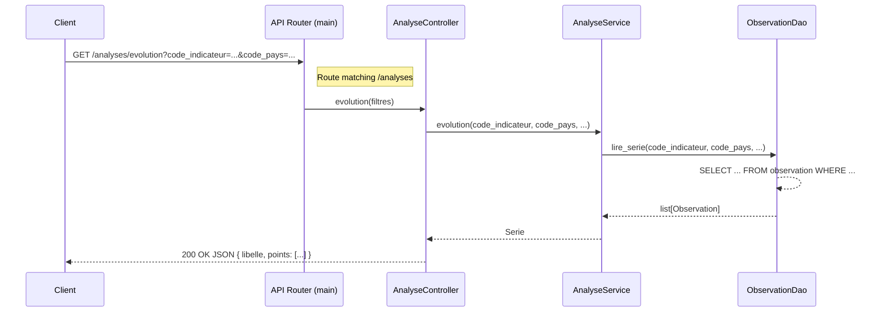

# Backend - API LaborScope

[English](README.md) | **Français**

Cœur de l'application : une API REST en architecture par couches construite avec
[FastAPI](https://fastapi.tiangolo.com/), qui collecte, stocke et analyse les
statistiques du marché du travail issues des données ouvertes
[ILOSTAT](https://ilostat.ilo.org/), avec gestion des utilisateurs et génération de
rapports PDF.

## 🚀 Lancer l'application

Commandes à exécuter depuis la racine du dépôt :

- Installer toutes les dépendances : `uv sync --project backend --all-extras`
  - option all-extras : inclut les dépendances de développement
- Lancer l'API en mode développement : `uv run --project backend python backend/src/main.py`

:bulb: Au premier lancement, initialisez la base de données avec les fichiers SQL de
`data/` (`init_db.sql` pour les tables, puis `pop_referentiels.sql` pour les
référentiels).

## 🏛️ Architecture

Le backend suit une **architecture par couches** (N-Tier) pour garantir la séparation
des responsabilités et la maintenabilité. Les dépendances pointent toujours vers le bas :

```
controller  →  service  →  dao  →  business_object
```

- **Business Object** (`business_object/`) : entités métier pures, **une classe par
  fichier**, sans logique (porteuses de données). Les énumérations sont dans `enums.py`.
- **Controller** (`controller/`) : routage HTTP via FastAPI, **aucun calcul**.
- **Model** (`model/`) : contrats de données de l'API via [Pydantic](https://pydantic.dev/)
  (requête/réponse).
- **Service** (`service/`) : la logique métier (collecte, parsing, analyse, auth, admin,
  rapports).
- **Client** (`client/`) : le seul module qui appelle l'API externe ILOSTAT.
- **DAO** (`dao/`) : accès à la base de données, un DAO par entité, au-dessus de
  `db_connection.py`.
- **Utils** (`utils/`) : outils transversaux (config, sécurité, planificateur, PDF,
  graphiques, journalisation).

### Structure du projet

```text
backend/
├── Dockerfile                      # Image conteneur de l'API
├── logging_config.yml              # Configuration de la journalisation structurée
├── pyproject.toml                  # Métadonnées du projet & dépendances (uv)
├── uv.lock                         # Versions figées des dépendances
│
├── src/
│   ├── main.py                     # App FastAPI : branche les routeurs, démarre le planificateur
│   │
│   ├── business_object/            # Entités métier (une classe par fichier, sans logique)
│   │   ├── enums.py                #   Role, Sexe, TypeClassification, StatutImport, StatutRapport
│   │   ├── utilisateur.py          #   Utilisateur : compte applicatif
│   │   ├── pays.py                 #   Pays : code_pays + nom_pays
│   │   ├── indicateur.py           #   Indicateur ILOSTAT
│   │   ├── classification.py       #   Classification (base : age ou occupation)
│   │   ├── age.py                  #   Age(Classification) : age_min / age_max
│   │   ├── occupation.py           #   Occupation(Classification) : code ISCO
│   │   ├── observation.py          #   Observation : valeur mesurée (+ sexe, import_id)
│   │   ├── import_donnees.py       #   ImportDonnees : trace d'un import
│   │   ├── journal_activite.py     #   JournalActivite : action sensible tracée
│   │   └── rapport.py              #   Rapport : rapport PDF demandé
│   │
│   ├── controller/                 # Routes HTTP (FastAPI), aucun calcul
│   │   ├── dependances.py          #   Dépendances auth : utilisateur courant, exiger_connexion/admin
│   │   ├── auth_controller.py      #   Inscription, connexion, profil courant
│   │   ├── referentiel_controller.py #  Listes : indicateurs, pays, classifications
│   │   ├── analyse_controller.py   #   Évolution (libre), comparaisons, carte
│   │   ├── rapport_controller.py   #   Demande, liste, téléchargement des rapports PDF
│   │   └── admin_controller.py     #   Imports, données, comptes, journal
│   │
│   ├── model/                      # Schémas Pydantic (entrées/sorties de l'API)
│   │   ├── auth_model.py           #   Identifiants (in), Jeton (out)
│   │   ├── utilisateur_model.py    #   Création (in), sortie sans mot de passe (out)
│   │   ├── analyse_model.py        #   Filtres (in), séries & comparaisons (out)
│   │   ├── import_model.py         #   Résultat d'un import (out)
│   │   └── rapport_model.py        #   Demande (in), rapport (out)
│   │
│   ├── service/                    # Logique métier (fonctionnalités F1–F6, FO3)
│   │   ├── collecte_service.py     #   F1 : télécharge, parse, enregistre, trace l'import
│   │   ├── parser_service.py       #   F2 : CSV/JSON → Observation, rejette l'invalide
│   │   ├── referentiel_service.py  #   Listes d'indicateurs, pays, classifications
│   │   ├── analyse_service.py      #   F3/F4/F5 + carte : séries et comparaisons
│   │   ├── authentification_service.py #  F6 : mot de passe, jeton, contrôle de rôle
│   │   ├── utilisateur_service.py  #   F6 : inscription, promotion admin, désactivation
│   │   ├── donnees_service.py      #   F6 : recherche, correction, suppression (admin)
│   │   ├── journal_service.py      #   F6 : enregistre et consulte le journal
│   │   └── rapport_service.py      #   FO3 : assemble séries + graphiques + PDF
│   │
│   ├── client/
│   │   └── ilostat_client.py       # Seul appel à l'API ILOSTAT (contenu brut)
│   │
│   ├── dao/                        # Accès à la base (un DAO par entité)
│   │   ├── db_connection.py        #   Connexion PostgreSQL unique (singleton)
│   │   ├── indicateur_dao.py       #   Lecture / création des indicateurs
│   │   ├── pays_dao.py             #   Lecture / création des pays
│   │   ├── classification_dao.py   #   Lecture / création des classifications
│   │   ├── observation_dao.py      #   Upsert par lot, lecture série/période, modif, suppr.
│   │   ├── import_dao.py           #   Enregistre et liste les imports
│   │   ├── utilisateur_dao.py      #   Crée, recherche, modifie les comptes
│   │   ├── journal_dao.py          #   Écrit et lit le journal
│   │   └── rapport_dao.py          #   Enregistre et liste les rapports
│   │
│   └── utils/                      # Outils transversaux
│       ├── config.py               #   Lecture du fichier .env
│       ├── securite.py             #   Hachage mot de passe, jetons
│       ├── journalisation.py       #   Logs techniques + décorateur @log + middleware
│       ├── planificateur.py        #   Déclenche la collecte périodique
│       ├── graphiques.py           #   Courbes / barres pour le PDF
│       ├── pdf.py                  #   Mise en page du rapport
│       ├── exceptions.py           #   Erreurs métier communes
│       ├── singleton.py            #   Métaclasse Singleton
│       └── reset_database.py       #   Recrée la base pour les tests
│
└── tests/                          # Tests organisés par couche
    ├── conftest.py                 #   Charge les variables d'environnement
    ├── business_object/
    ├── dao/
    └── service/
```

> Les données vivent à la racine du dépôt dans `data/` : `init_db.sql` (tables +
> contrainte d'unicité sur `observation`), `pop_referentiels.sql` (pays, classifications,
> les deux indicateurs), `pop_db_test.sql` (fixtures pour les tests DAO).

### Couches

Diagramme de séquence du flux d'analyse temporelle (F3, accès libre) à travers les
couches :



Les diagrammes de classes complets (Mermaid, importables dans Lucidchart) sont dans
`doc/` : `class_diagram_domaine.mmd` (modèle de domaine + héritage) et
`class_diagram_couches.mmd` (couches service/DAO + méthodes + composition).

### Fichiers de configuration

Dans les dossiers backend et frontend, vous trouverez :

| Élément               | Description                                         |
| --------------------- | --------------------------------------------------- |
| logging_config.yml    | Configuration du système de journalisation structurée. |
| pyproject.toml        | Métadonnées du projet et définition des dépendances. |
| uv.lock               | Fichier de verrouillage garantissant des environnements reproductibles en figeant les versions exactes des dépendances. |
| \_\_init\_\_.py       | Marque un dossier comme package Python, autorisant les imports de modules. |

## ⚒️ Boîte à outils de développement

### Débogage & Logs

L'application utilise un système de journalisation structurée. Les logs sont écrits dans
le dossier `backend/logs/` et suivent le format défini dans `logging_config.yml`.

Un décorateur personnalisé `@log` (dans `utils/journalisation.py`) enregistre
automatiquement les entrées et sorties des méthodes, ce qui facilite grandement le suivi
du flux de données à travers les services.

### Tests unitaires

Pour garantir des tests reproductibles, sûrs et qui **n'interfèrent pas avec la vraie
base de données**, nous utilisons un schéma dédié aux tests unitaires. Les tests
unitaires DAO utilisent les données du fichier `data/pop_db_test.sql`, chargées dans un
schéma séparé (`project_test_dao`) afin de ne pas polluer les autres données. Les tests
sont organisés par couche sous `tests/` (`business_object/`, `dao/`, `service/`).

- [ ] Lancer les tests unitaires : `uv run --project backend pytest -v`

Il est aussi possible de générer la couverture des tests avec
[Coverage](https://coverage.readthedocs.io/en/) :

- [ ] `uv run --project backend coverage run -m pytest backend`
- [ ] `uv run --project backend coverage report -m`
- [ ] `uv run --project backend coverage html`
  - Télécharger et ouvrir coverage_report/index.html

### Ruff

Le **formatage à la sauvegarde** avec [Ruff](https://docs.astral.sh/ruff/) est activé par
défaut dans l'espace de travail (cf. *.vscode/settings.json*).

Pour le faire manuellement :

- garantit un style de code cohérent et lisible : `uv run --project backend ruff format backend/`
- identifie et corrige les problèmes potentiels : `uv run --project backend ruff check --fix backend/`

### Pylint

Analyse statique avec **pylint** : `uv run --project backend --extra dev pylint --output-format=colorized --disable=C0114,C0411,C0415,W0718 $(git ls-files 'backend/**/*.py') --fail-under=7.5`
